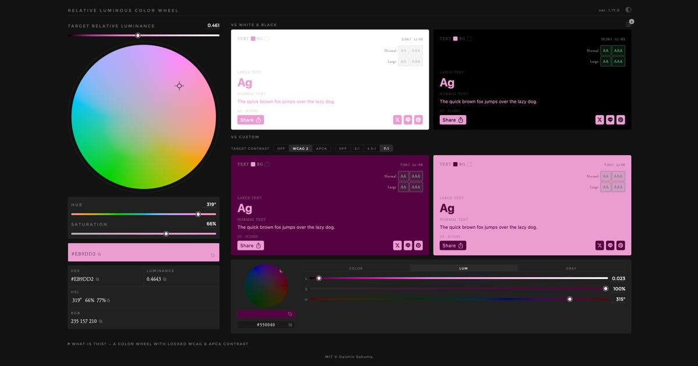

# Relative Luminous Color Wheel

> **A free, open-source accessible color picker & WCAG 2.2 / APCA contrast checker.** Lock a contrast ratio, explore luminance-stable hues so the contrast never breaks, check opacity-aware (composited) contrast, then build accessible palettes and light/dark themes and export CSS, Tailwind v4, shadcn/ui or W3C design tokens (DTCG) — with full color-blindness (CVD) simulation. No account, runs entirely in your browser.

**An accessibility-first color and design-token workspace, built on a WCAG 2.2 contrast lock.** Every color on the wheel shares the same WCAG 2.2 relative luminance, so you can explore hue and saturation freely while the contrast against your background never breaks — and a target lock (WCAG 2.2 ratios, or an experimental APCA Lc target) keeps a color pair pinned to a threshold in real time, opacity included: translucent colors are checked on their composited (alpha-blended) result. From there, build an accessible palette, generate a luminance-keyed tonal scale plus light/dark themes with Material-3-style semantic roles (surfaces, accent with hover/active and a container pair, and success/warning/danger/info status colors), preview them in a realistic page mock followed by a component gallery, and export tool-ready CSS, Tailwind v4, a shadcn/ui theme, or W3C design tokens. Meet WCAG 2.1/2.2 AA — the standard referenced by the ADA and the European Accessibility Act — *by construction*, not by after-the-fact auditing.

**Live:** https://relative-luminous-color-wheel.vercel.app/

## Why this exists

The usual workflow treats accessibility as an afterthought: pick a color, run it through a contrast checker, fail, adjust, repeat. This tool inverts the loop — **contrast is a constraint you set first, not something you verify afterwards.**

- **The wheel is luminance-locked.** Set a target relative luminance and the wheel redraws so every reachable hue/saturation renders at exactly that luminance. WCAG contrast ratios are computed from relative luminance alone, so an AA or AAA rating cannot break while you explore.
- **The target contrast lock goes further.** Hold a WCAG 2.2 threshold (3:1, 4.5:1, 7:1) or an APCA lightness-contrast target (Lc 45–90), move either color, and the other side re-pins itself to the boundary — landing on the first representable RGB at-or-beyond the target, every input tick.

## Features

- **Luminance-locked wheel** — rendered by a WebGL fragment shader (per-pixel lightness search), with a chunked 2D canvas fallback. In APCA mode every wheel (main, custom, and the palette re-edit picker) equalizes APCA screen luminance (Ys) instead of WCAG relative luminance, so exploration stays contrast-stable under whichever method is active
- **Target contrast lock** — `Off / WCAG 2 / APCA` modes; WCAG 2.2 thresholds where text ratings change (3:1 large text & UI, 4.5:1 normal AA, 7:1 AAA), or experimental APCA Lc 45/60/75/90 (a newer perceptual method — WCAG 2.2 remains the normative default)
- **Live contrast readouts** — WCAG 2.2 AA/AAA badges for normal text, large text, and UI components against white, black, and a custom color, with APCA Lc values alongside every ratio; saved palette swatches appear as a compact preview strip in every contrast tile. In APCA mode each tile switches to full APCA verdicts: the official usage ladder (SMALL BODY TEXT ONLY … SPOT & NON TEXT ONLY … INVISIBLE), a font-size/weight verdict against the official apca-w3 lookup table (with the required minimum size when it fails), and in-tile font size/weight selectors — judged from the continuous luminance pair, so hue/sat exploration never shakes the verdicts, and pinned to exactly the target while a contrast lock is met
- **Custom comparison color** — three modes: **Color** (RGB/HSL), **Lum** (relative luminance / saturation / hue), **Gray** (neutral grayscale)
- **Opacity & composited contrast** — set an opacity on the main text, the custom background, or any saved palette color, and contrast is measured on the *composited* (alpha-blended) result: a translucent color blends over its background — a see-through background over a configurable page underlay set in Preferences (RGB / HSL / Lum / Gray, defaulting to white) — before its WCAG ratio and APCA Lc are computed, in a hue-invariant luminance space so exploring hue/saturation never shakes the verdict. The alpha slider sits with luminance in the Lum picker, because opacity — unlike hue/saturation — changes contrast. Both the WCAG and APCA locks hold the visible, composited contrast at any opacity, re-pinning the untouched side to the closest achievable pair and flagging when a target is physically unreachable ("Text can't reach 7:1" / "BG can't reach Lc 60"). Opacity survives export — 8-digit `#RRGGBBAA` hex, `rgba()`/`oklch()` with an alpha channel, and alpha-ready tokens — and every hex field accepts 3/4/6/8-digit shorthand
- **Verdicts that never disagree** — the measured value, its pass/fail chips, the APCA usage tier and font verdict, and the lock's own reached / "can't reach" state are all derived from one value each frame, so the ratio (or Lc) you read and the verdict beside it are always in lockstep — even mid-drag
- **Palette sidebar** — pin colors as text or background roles, each named by rank for the first ten (Primary → Denary) then by ordinal, up to 24 per role; re-edit any saved color in place with an inline RGB / HSL / Lum / Gray picker (mini wheel + sliders, defaulting to Lum), where the wheel's picker ring stays visible on any background and each numeric field selects-all on focus and steps with the arrow keys; smooth open/close transitions, automatic centering in the sidebar, and a live contrast preview against a selectable opposite-role color (each side labelled with its role and rank — e.g. "Text Primary on BG Primary" — rendered in the preview colors so the label itself is a contrast sample, with 3:1 / 4.5:1 / 7:1 pass indicators for large-text, normal-text, and AAA thresholds — or, in APCA mode, the APCA verdicts instead: Lc value, official usage level, and the chosen font-size/weight verdict with the required minimum size); tap outside the editor to save like Done, cancel editing to revert changes, save an identical color more than once and tune each copy afterwards, drag the sidebar right and release to close it on touch devices (with a smooth, iCloud Mail-style spring-back transition on cancel), and reorder saved colors by dragging each chip's grip handle — reliable across Android, iOS, and desktop — while the chip body still scrolls the list natively (including moves between Text and Background groups, with the group labels following the reordering); undo and redo any palette edit — add, delete, re-edit, reorder, or clear; the sidebar widens to give sliders more room (up to 480px, 90% of the viewport on small screens); persists locally and travels in share links
- **Accessible color-system generator** — from your current colors, build a luminance-keyed tonal scale (50–950, a linear OKLab lightness ramp with gamut-clamped chroma so it's smooth by construction) plus ready-made light and dark themes with **Material-3-style semantic roles**: surfaces (`background`, `surface`, an elevated `surface-2`, `border`), `text` and `muted`, an **accent** with `hover`/`active` interaction states and a soft **container** pair (`accent-container` + on-color), and **success / warning / danger / info** status colors that each carry a container fill and an on-color. Each step is solved to a target luminance, so text, muted, accent and the container on-colors pass by construction. Source the scale from a text↔background gradient or either color alone
- **Theme preview** — preview a generated theme (or your saved palette) in a realistic **page mock** followed by a **component gallery**, both in a single scroll (no tab to miss): the gallery dresses real UI in the theme's roles — buttons (primary / secondary / destructive / ghost) across **default · hover · active · disabled**, inputs (default / focus / disabled), status badges from the container pairs, and a table — so every M3 role appears in the component it names. Save a theme's full role set to the palette, or import individual scale/theme colors into a role
- **Export** — CSS custom properties, a Tailwind v4 `@theme` block, a ready-to-paste **shadcn/ui theme** (scale export only: `:root` + `.dark` blocks mapped to shadcn's own token names — background, foreground, card, popover, primary, secondary, muted, accent, destructive, border, input, ring, chart-1…5 and the sidebar set), or W3C Design Tokens (DTCG) JSON. In the token JSON every color `$value` is the **DTCG Format Module 2025.10 object form** — `{ colorSpace, components, hex }` — which spec-aware tools (Style Dictionary, Tokens Studio, Terrazzo) read from `components` while the `hex` property is the spec's own built-in fallback for hex-only importers, so it's the widest-compatible shape; relative luminance rides under reverse-DNS `$extensions` (which tools MUST preserve), theme colors are standard `{alias}` references, and the media type is `application/design-tokens+json`. The toggle picks the `colorSpace` (`srgb` components 0–1, or `oklch` `[L, C, H]`); alpha appears only when `< 1`. Token/variable **names preserve the case you type** (CSS and DTCG names are case-sensitive) while color **values stay lowercase**. In the global-token (scale) export, the semantic theme layer is **alias-only across CSS, Tailwind and JSON** — every role points at a scale step or a named base primitive (never a hard-coded colour), so re-theming is swapping references. Exports prioritize saved swatches while backing up active main picker colors inside JSON extensions and comments
- **Color vision simulation** — protanopia / deuteranopia / tritanopia (Machado et al. 2009 matrices, applied in linear-light space) rendered by the app itself: every canvas pixel, slider gradient, inline color, and theme variable is transformed, so the full-screen preview — theme, wheel, preferences, and palette sidebar included — is identical on iOS/Safari, Android, and desktop browsers (no CSS/SVG reference filters, which iOS WebKit does not propagate into composited layers).
- **Fit-to-screen desktop layout** — on PC the whole app continuously scales to use the entire window exactly, at any size or aspect ratio, with no scrolling: spare width grows the wheel and sliders instead of leaving dead space
- **Shareable links** — colors, palette, and UI theme travel in the URL, so recipients see exactly what you see (each part can be opted out in Preferences)
- **Copy-ready values** — click any hex, HSL, or RGB value to copy it
- **Appearance controls** — adjustable UI hue, saturation, and brightness with a dark/light theme toggle
- **Private by design** — no account, no upload; everything runs locally in your browser

## Tech stack

- [Vite](https://vite.dev) — build tooling; zero runtime dependencies (vanilla JavaScript & CSS)
- WebGL fragment shader renders the luminance-locked wheel; chunked 2D canvas fallback
- WCAG 2.2 relative luminance (`L = 0.2126R + 0.7152G + 0.0722B`) and contrast-ratio math
- APCA-W3 0.0.98G-4g lightness contrast (reference values and lock targets; WCAG 2.2 remains normative)
- OKLCH conversion (Björn Ottosson's OKLab transform) for exports; sRGB hex fallback retained
- Font: [NATS](https://www.figma.com/fonts/nats/)

## Contributing

The whole app is three files — `index.html`, `src/main.js`, `src/style.css` — with no runtime dependencies, which makes it an approachable codebase for first contributions. See [CONTRIBUTING.md](./CONTRIBUTING.md) to get started.

## License

[MIT](./LICENSE) © 2026 Daishin Sakuma
